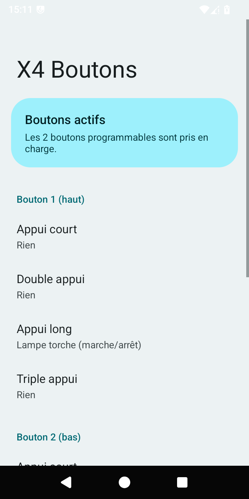

# Crosscall Core-X4 (L762) — LineageOS 21 (Android 14)

Correctifs et outils pour faire tourner une **GSI LineageOS 21** sur le **Crosscall Core-X4**
(modèle **L762**, SoC Qualcomm **SDM450/MSM8953**, noyau **4.9**, vendor Android 10).

> ⚠️ **Ce n'est pas un portage officiel LineageOS.** C'est une **GSI générique**
> ([TrebleDroid d'AndyYan](https://sourceforge.net/projects/andyyan-gsi/)) à laquelle on applique
> quelques correctifs spécifiques au Core-X4, en **conservant le `boot.img` et le `vendor` d'origine**
> de Crosscall (Android 10). LineageOS ne distribue pas ce genre de montage.

---

## État des fonctions (testé sur un Core-X4 FR00 en Android 10 d'origine `6.14.16`)

| Fonction | État |
|---|---|
| Démarrage, chiffrement `/data` (FBE) | ✅ |
| Wi-Fi, Bluetooth, GPS, NFC (détection) | ✅ |
| Appels, SMS, données mobiles 4G | ✅ |
| Appareil photo avant / arrière | ✅ |
| Empreinte digitale | ✅ |
| Google Play (variante GApps) | ✅ |
| 2 boutons programmables + réveil écran éteint | ✅ (appli **X4 Boutons** incluse) |
| **VoLTE (appels 4G HD)** | ❌ l'IMS ne s'enregistre pas (limite GSI, voir plus bas) |
| Autonomie | ⬜ à juger à l'usage |
| **LineageOS 22.2 (Android 15)** | ❌ bloque au logo noyau : le ramdisk Android 10 d'origine est incompatible avec l'init d'A15 |

---

## ⚠️ Avertissements

- **Déverrouiller le bootloader efface tout le téléphone.**
- **NE JAMAIS faire « Factory data reset » depuis le recovery Crosscall** : il casse le démarrage
  (il restaure le vbmeta d'origine). Pour réinitialiser : relancer le flash, ou passer par
  Paramètres > Système sous LineageOS.
- **Faites un dump complet de vos partitions AVANT** (boot, recovery, vendor, vbmeta, modemst1/2,
  fsg, persist…). Il n'existe pas de firmware complet officiel pour revenir à la ROM Crosscall ;
  le dump est votre seule porte de retour.
- Vous faites ça à vos risques. Aucune garantie.

---

## Prérequis

1. Un Core-X4 **sous Android 10 Crosscall** (version 6.xx). Un X4 encore en Android 9 : faire les MAJ d'abord.
2. **Bootloader déverrouillé** :
   - Paramètres > À propos > 7 appuis sur « Numéro de build »
   - Options développeur : activer « Déverrouillage OEM » et « Débogage USB »
   - `adb reboot bootloader`
   - `fastboot flashing get_unlock_ability` (doit répondre `1`)
   - `fastboot flashing unlock` → confirmer sur le téléphone (**efface tout**)
3. **Google platform-tools r34.0.5** (les versions 36/37 plantent : `bad_alloc` sur le flash sparse) :
   https://dl.google.com/android/repository/platform-tools_r34.0.5-windows.zip

---

## Image prête à flasher

Pas envie de reconstruire ? Une image système déjà corrigée est disponible dans les
[**Releases**](https://github.com/corex4-lineage/core-x4-lineageos/releases)
(`x4_lineage21_gapps_system.img.xz`, ~969 Mo → ~4 Go décompressée) + `vbmeta_disabled.img`.
Décompresser (`xz -d` / 7-Zip), puis flasher avec `flash/FLASH_X4.ps1` (voir plus bas).

## Construire l'image système (soi-même)

Il faut une GSI de base + ce dépôt, sous Linux ou WSL (`e2fsprogs` + `python3`).

```bash
# 1. Récupérer la GSI LineageOS 21 arm64 "bgN" (variante GApps) d'AndyYan :
#    https://sourceforge.net/projects/andyyan-gsi/files/lineage-21-td/
#    puis la décompresser en un .img

# 2. Appliquer les correctifs Core-X4 :
cd patches
cp /chemin/vers/lineage-21.0-xxxxxxxx-UNOFFICIAL-arm64_bgN.img ./system.img
./patch_gsi.sh system.img
```

`patch_gsi.sh` applique les 5 correctifs décrits ci-dessous et agrandit l'image à 4000 Mo.

> L'appli `X4Boutons.apk` est fournie pré-compilée dans `app/prebuilt/` (reconstructible, voir `app/`).

---

## Flasher (Windows)

Téléphone en mode fastboot (éteint, puis **Volume bas + Power**), branché en USB.

```powershell
powershell -ExecutionPolicy Bypass -File flash\FLASH_X4.ps1
```

Le script vérifie le modèle (L762) et le déverrouillage, demande `OUI`, puis flashe :
`vbmeta` (vérification AVB désactivée), `system`, et formate `userdata`/`metadata`/`cache`
à la taille du téléphone, puis redémarre. Premier démarrage : 3 à 5 min.

Si PowerShell 5.1 fait échouer le script sur la gestion de stderr, les commandes équivalentes en direct :

```bash
fastboot --disable-verity --disable-verification flash vbmeta vbmeta_disabled.img
fastboot flash system system.img
# userdata/metadata/cache : mke2fs -F -t ext4 -b 4096 [-O encrypt,quota] -E android_sparse
#   à partir de (fastboot getvar partition-size:<part>) / 4096 blocs, puis fastboot flash <part>
fastboot reboot
```

---

## Les 5 correctifs (voir `patches/patch_gsi.sh`)

1. **Chiffrement (trousseau fscrypt).** Le noyau 4.9 n'a pas `FS_IOC_ADD_ENCRYPTION_KEY` et l'init
   d'Android 12+ ne crée plus le trousseau `fscrypt` → `vold` échoue (`enablefilecrypto_failed`).
   Correctif : un mini binaire ELF ARM64 fait main (`x4keyring`, 172 octets, source
   `mk_keyring_elf.py`) qui appelle `add_key("keyring","fscrypt",…,KEY_SPEC_SESSION_KEYRING)`,
   lancé par init au démarrage (`x4keyring.rc`). Nécessite `(typepermissive init)` dans
   `plat_sepolicy.cil` (contrepartie : init en permissif).
2. **/persist.** Dossier vide dans la GSI → remplacé par un lien vers `/mnt/vendor/persist`
   (sinon la zone sécurisée Qualcomm / keymaster n'accède pas à son stockage).
3. **APEX compressés (`.capex`).** Non décompressés sur ce téléphone → `bpfloader-failed` en boucle
   (icône de charge). Les `.capex` sont remplacés par leur `.apex` d'origine (signature intacte).
4. **Boutons programmables.** `gpio-keys.kl` (codes Crosscall `530`/`531` → `F12`/`F11`, avec `WAKE`)
   + appli système **X4 Boutons** (la gestion Crosscall d'origine était codée dans le framework A10).
5. **Réglages du 1er démarrage (`x4defaults.sh`).** Voyant de batterie coupé (le HAL lumière Crosscall
   le branche sur le flash photo : la lampe s'allumait en charge) + activation du service X4 Boutons.

---

## X4 Boutons (dossier `app/`)

Petite appli qui remplace la gestion native des 2 boutons physiques (perdue en passant en GSI).
Service d'accessibilité sur `F11`/`F12`, gestes **appui court / double / long / triple** →
lampe, photo, lancer une appli, capture d'écran, notifications, réglages rapides, assistant, etc.
Réveil écran éteint pris en charge. UI façon Paramètres LineageOS (Material You).

Compilée **sans Gradle** (`app/build.sh`). Voir `app/README.md`.



---

## Pourquoi la VoLTE ne marche pas

L'IMS ne s'enregistre pas sur une GSI : l'appli IMS du vendor Qualcomm (`org.codeaurora.ims`) exige
le `sharedUserId android.uid.phone`, donc la **signature plateforme**. La GSI d'AndyYan est signée
avec **sa** clé privée (pas la test-key AOSP), donc impossible de re-signer l'appli vendor pour
qu'elle y soit admise. Sans conséquence pratique : les appels passent en 2G/3G tant que l'opérateur
les maintient ; on perd seulement les appels 4G HD et le maintien de la 4G pendant un appel.

---

## Limites

- **Pas d'OTA.** Nouvelle GSI = relancer `patches/patch_gsi.sh` dessus.
- **Android 14 semble être le plafond** sur ce vendor A10 sans retoucher le `boot.img` :
  la 22.2 (A15) bloque à l'init (ramdisk A10 incompatible).
- Retour à la ROM Crosscall : pas de firmware complet officiel → **dump de vos partitions indispensable** avant.

---

## Crédits

- GSI de base : **AndyYan** (LineageOS TrebleDroid GSI).
- Projets **LineageOS** et **phhusson/treble_experimentations**.
- Correctifs Core-X4 et appli X4 Boutons : ce dépôt.

## Licence

[GPL-3.0](LICENSE).
